# C4 — Componentes

**Status:** decomposição lógica alinhada à arquitetura ratificada; não é descrição de implementação existente. ADRs relacionados: [ADR-001](../adr/ADR-001-monolito-modular-em-camadas.md), [ADR-003](../adr/ADR-003-protecao-contra-dupla-reserva.md), [ADR-004](../adr/ADR-004-fronteiras-transacionais.md), [ADR-005](../adr/ADR-005-autenticacao-e-autorizacao.md), [ADR-007](../adr/ADR-007-auditoria-operacional.md) e [ADR-008](../adr/ADR-008-notificacoes-e-integracoes.md).

```mermaid
C4Component
    title Organização de Recursos — Componentes planejados
    Container_Boundary(app, "Aplicação Java / Spring Boot") {
        Component(controllers, "Controllers", "API", "Adaptam requisições e respostas; sem regra de conflito")
        Component(security, "Segurança", "Spring Security / JWT", "Autenticação stateless e autorização por operação, papel e propriedade")
        Component(reservationUseCases, "Casos de uso de reserva", "Aplicação", "Consulta disponibilidade e coordena criação/gestão transacional")
        Component(approvalUseCases, "Casos de uso de aprovação", "Aplicação", "Coordena decisão e validação docente; critérios Q-05/Q-06")
        Component(resourceUseCases, "Casos de uso de recursos", "Aplicação", "Cadastros e gestão de salas, professores, materiais e usuários")
        Component(maintenanceUseCases, "Casos de uso de bloqueio/manutenção", "Aplicação", "Coordena gravação e análise de impacto conforme Q-08")
        Component(materialUseCases, "Casos de uso de materiais", "Aplicação", "Acompanhamento de retirada/devolução conforme Q-07")
        Component(domain, "Domínio", "Modelo e políticas", "Validação temporal, conflito e transições após decisões aprovadas")
        Component(ports, "Portas de repositório", "Interfaces", "Contratos de leitura/gravação usados pelos casos de uso")
        Component(persistence, "Adaptadores PostgreSQL", "Spring Data JPA / Hibernate / Flyway", "Transações e consultas PostgreSQL; locks pessimistas ordenados e revalidação")
        Component(audit, "Porta/adaptador de auditoria", "Persistência transacional", "Registra eventos mínimos na mesma transação da mutação")
        Component(notifications, "Porta/adaptador de notificação", "Opcional", "Só se Q-13 confirmar canal/eventos")
        Component(reports, "Consultas/relatórios", "Opcional", "Projeções somente após escopo Q-12")
    }
    ContainerDb(db, "PostgreSQL", "Banco adotado", "Dados relacionais e integridade transacional")
    Rel(controllers, security, "Autentica identidade")
    Rel(controllers, reservationUseCases, "Invoca consultas e comandos")
    Rel(controllers, approvalUseCases, "Invoca decisão/validação")
    Rel(controllers, resourceUseCases, "Invoca gestão de cadastros")
    Rel(controllers, maintenanceUseCases, "Invoca gestão de períodos")
    Rel(controllers, materialUseCases, "Invoca acompanhamento")
    Rel(reservationUseCases, domain, "Aplica políticas de reserva")
    Rel(approvalUseCases, domain, "Valida transições aprovadas")
    Rel(maintenanceUseCases, domain, "Valida intervalo e impacto aprovado")
    Rel(materialUseCases, domain, "Aplica políticas de material aprovadas")
    Rel(reservationUseCases, security, "Autoriza operação e propriedade")
    Rel(approvalUseCases, security, "Autoriza ator e decisão")
    Rel(resourceUseCases, security, "Autoriza operação administrativa")
    Rel(maintenanceUseCases, security, "Autoriza operação e impacto")
    Rel(materialUseCases, security, "Autoriza acompanhamento")
    Rel(reservationUseCases, ports, "Lê/grava sob transação")
    Rel(approvalUseCases, ports, "Lê/grava decisão sob transação")
    Rel(resourceUseCases, ports, "Lê/grava cadastros")
    Rel(maintenanceUseCases, ports, "Lê/grava bloqueios sob transação")
    Rel(materialUseCases, ports, "Lê/grava eventos/quantidades definidos")
    Rel(ports, persistence, "Porta implementada por adaptador")
    Rel(persistence, db, "JPA/SQL, migrações Flyway e constraints")
    Rel(reservationUseCases, audit, "Grava evento mínimo na mesma transação")
    Rel(approvalUseCases, audit, "Grava evento mínimo na mesma transação")
    Rel(resourceUseCases, audit, "Grava mutações administrativas na mesma transação")
    Rel(maintenanceUseCases, audit, "Grava evento mínimo na mesma transação")
    Rel(materialUseCases, audit, "Grava evento mínimo na mesma transação")
    Rel(reservationUseCases, notifications, "Somente se evento/canal aprovados")
    Rel(reports, ports, "Consulta dados sem controlar escrita de reserva")
    Rel(controllers, reports, "Invoca consulta somente se Q-12 aprovar")
```

## Regras de dependência

1. Controllers traduzem protocolo e autenticam identidade; autorização por operação/objeto também é aplicada no caso de uso/consulta conforme Q-10, não somente na borda.
2. Casos de uso definem fronteira transacional e dependem de interfaces; domínio permanece independente de Spring e do banco.
3. Adaptadores implementam portas e concentram SQL, mapeamento e tratamento técnico de constraints.
4. Auditoria mínima de mutações é obrigatória e atômica conforme ADR-007; retenção e acesso operacional ainda requerem decisão institucional. Relatórios e notificações permanecem fora do escopo decidido.
5. A aprovação especial é uma decisão distinta e não altera a ocupação por si só; somente as transições técnicas definidas em ADR-006 alteram a ocupação, sob lock e revalidação.