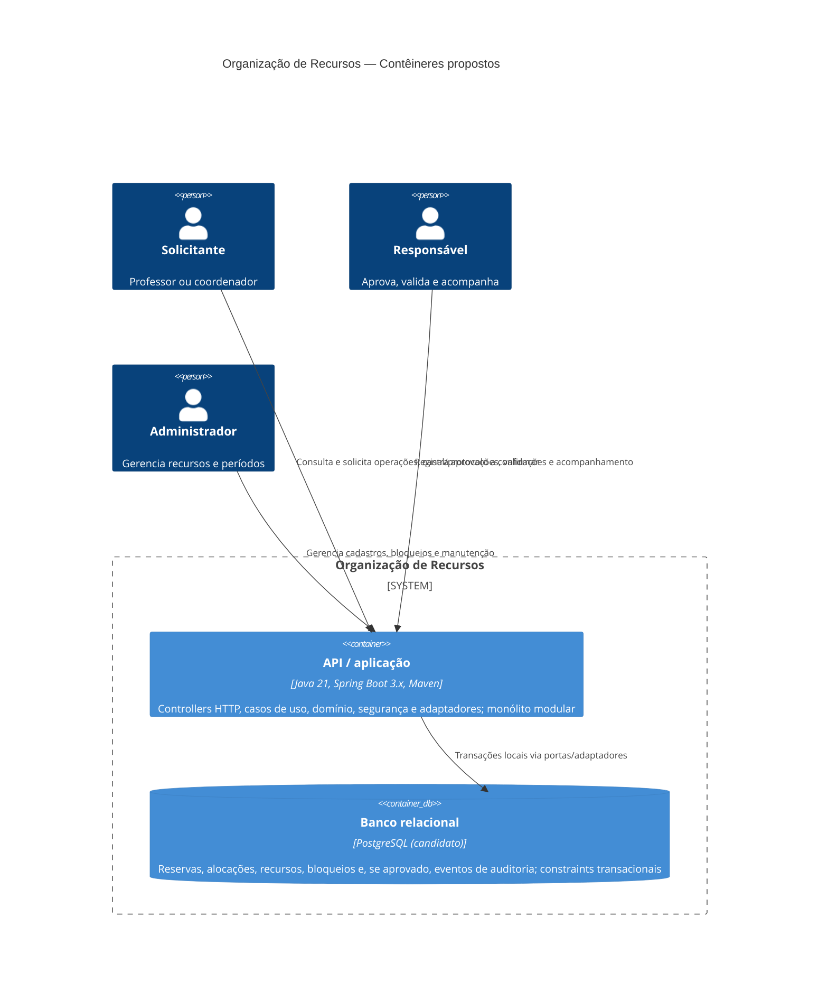

# C4 — Contêineres

**Status:** proposta para validação, não inventário de software implantado. A aplicação é candidata a monólito modular; PostgreSQL é candidato, não banco já escolhido/configurado. Ver [ADR-001](../adr/ADR-001-monolito-modular-em-camadas.md), [ADR-002](../adr/ADR-002-postgresql-como-persistencia.md) e [ADR-004](../adr/ADR-004-fronteiras-transacionais.md); todos aguardam ratificação.

## Notas de fronteira

- O contêiner de aplicação único mantém as gravações de reserva e alocações na mesma transação. Não se propõe um serviço separado para reservas, auditoria ou notificações.
- A API HTTP é uma opção compatível com controllers solicitados; não há contrato REST nem interface cliente definido nas fontes.
- PostgreSQL é favorecido pela possibilidade de constraints de exclusão e transações, mas requer validar Q-01/Q-02/Q-04 e a modelagem de materiais. Sem decisão, a persistência permanece candidata.
- Segurança é responsabilidade dentro do contêiner; provedor de identidade e mecanismo de autenticação não estão definidos.
- Auditoria operacional, relatórios e notificações são capacidades/módulos condicionais a Q-11/Q-12/Q-13, não contêineres ou integrações existentes. Não foi adicionado sistema externo por suposição.
- Ver [componentes](componentes.md) para os limites internos e [arquitetura](../arquitetura.md) para trade-offs.