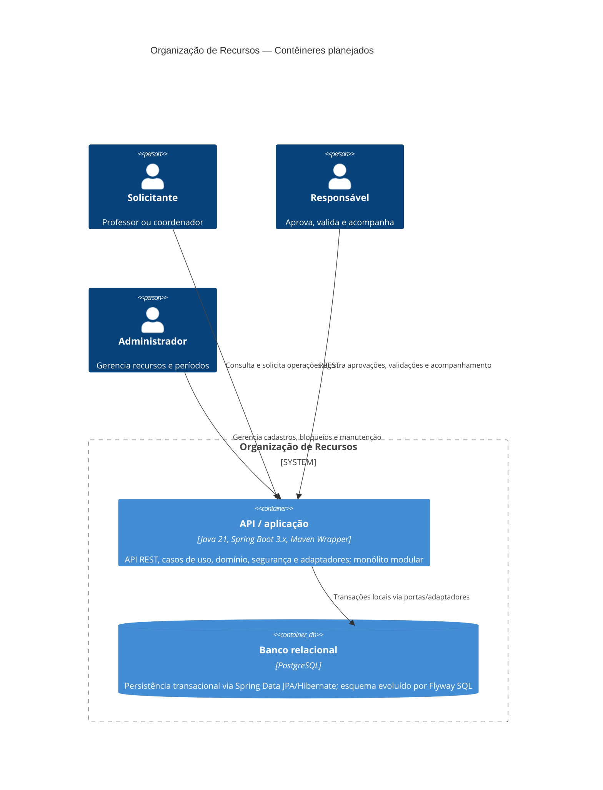

# C4 — Contêineres

**Status:** arquitetura lógica ratificada, não inventário de software implantado. Monólito modular e PostgreSQL foram escolhidos em [ADR-001](../adr/ADR-001-monolito-modular-em-camadas.md), [ADR-002](../adr/ADR-002-postgresql-como-persistencia.md) e [ADR-004](../adr/ADR-004-fronteiras-transacionais.md); nenhum está configurado ainda.

## Notas de fronteira

- O contêiner de aplicação único mantém as gravações de reserva e alocações na mesma transação. Não se propõe um serviço separado para reservas, auditoria ou notificações.
- A API REST foi decidida para o backend, mas não há endpoints implementados nem requisito de interface visual.
- PostgreSQL é o banco adotado. Locks ordenados e revalidação são a proteção principal contra concorrência; constraint de exclusão é apenas defesa adicional se o esquema permitir.
- Spring Security/JWT stateless é a decisão de segurança; chaves são externas e não há provedor externo de identidade no baseline.
- A auditoria mínima está definida em ADR-007 e participa da transação; a política de retenção/leitura aguarda decisão institucional. Relatórios/notificações permanecem fora do baseline.
- Ver [componentes](componentes.md) para os limites internos e [arquitetura](../arquitetura.md) para trade-offs.