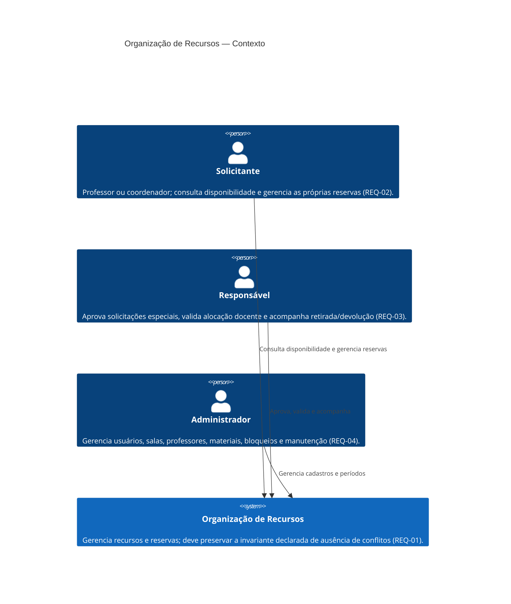

# C4 — Contexto do sistema

**Status:** proposta arquitetural; atores e capacidades vêm de REQ-01 a REQ-04. O canal de interação não foi especificado. Não há integrações externas aprovadas. Autenticação/autorização depende de Q-10 ([ADR-005](../adr/ADR-005-autenticacao-e-autorizacao.md)); notificações/integrações dependem de Q-13 ([ADR-008](../adr/ADR-008-notificacoes-e-integracoes.md)).

**Leitura:** usuário e sistema são os únicos elementos conhecidos. Interface web/mobile, identidade externa, correio, calendário e demais integrações não foram declarados e não são representados como sistemas existentes. A autorização dos perfis depende de Q-10; ações de aprovação e manutenção não implicam, por si, efeito sobre a ocupação (Q-05/Q-08).