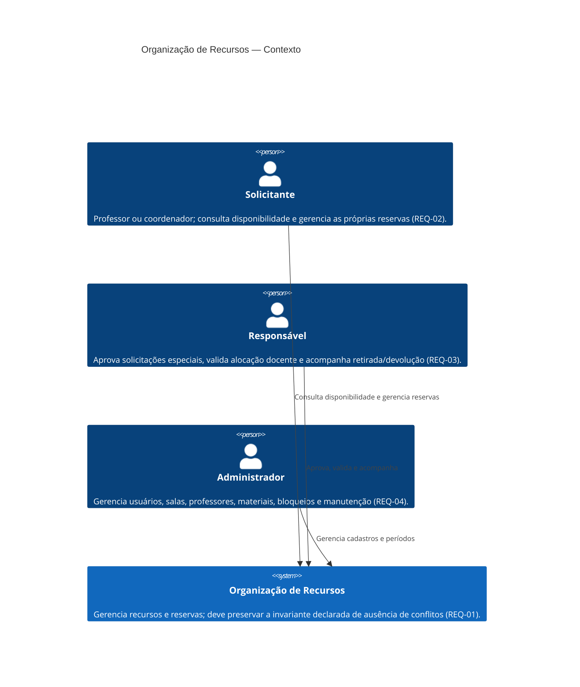

# C4 — Contexto do sistema

**Status:** contexto lógico alinhado aos ADRs ratificados; não representa software já implementado. A API REST é o canal decidido para o backend; interface visual e integrações externas não fazem parte do baseline. Segurança JWT e autorização seguem [ADR-005](../adr/ADR-005-autenticacao-e-autorizacao.md); notificações dependem de decisão futura conforme [ADR-008](../adr/ADR-008-notificacoes-e-integracoes.md).

**Leitura:** usuário e sistema são os únicos elementos conhecidos. Interface web/mobile, identidade externa, correio, calendário e demais integrações não são representados como sistemas existentes. Papéis e propriedade são verificados no servidor. Aprovação especial não é condição global para reserva; manutenção não cancela reservas automaticamente e segue a política de produto pendente em Q-08.