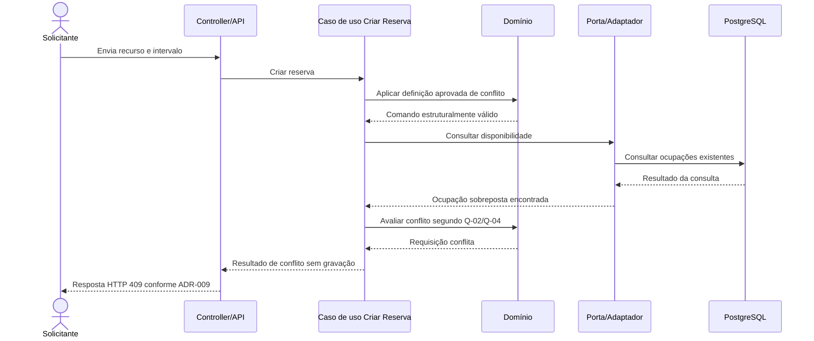

# Sequências propostas

Os diagramas descrevem interações lógicas entre [contêineres](conteineres.md) e [componentes](componentes.md); endpoints e nomes permanecem ilustrativos, não contratos implementados. Estados e políticas de produto ainda abertos não são presumidos. A concorrência usa locks pessimistas ordenados e revalidação; transações, auditoria mínima e erros seguem [ADR-003](../adr/ADR-003-protecao-contra-dupla-reserva.md), [ADR-004](../adr/ADR-004-fronteiras-transacionais.md), [ADR-007](../adr/ADR-007-auditoria-operacional.md) e [ADR-009](../adr/ADR-009-erros-http.md), ratificados.

## 1. Criação de reserva

Pré-condição conceitual: critérios funcionais de conflito/ocupação definidos (Q-01/Q-02/Q-04). A consulta ajuda a dar feedback, mas não é garantia contra corrida. O caso de uso bloqueia os registros estáveis dos recursos em ordem canônica, revalida a disponibilidade e grava a mutação e auditoria na mesma transação.

```mermaid
sequenceDiagram
    actor S as Solicitante
    participant API as Controller/API
    participant SEC as Segurança
    participant UC as Caso de uso Criar Reserva
    participant DOM as Domínio
    participant REP as Porta/Adaptador de reserva
    participant DB as PostgreSQL
    participant AUD as Auditoria mínima

    S->>API: Envia solicitação de reserva (contrato a definir)
    API->>SEC: Autoriza identidade e operação (Q-10)
    SEC-->>API: Resultado da política aprovada
    API->>UC: Criar reserva
    UC->>DOM: Validar intervalo, recursos e transição (Q-01/Q-02/Q-04)
    DOM-->>UC: Comando válido ou erro de domínio
    UC->>REP: Iniciar transação e bloquear recursos em ordem canônica
    REP->>DB: BEGIN; SELECT dos recursos com lock ordenado
    DB-->>REP: Locks adquiridos
    REP->>DB: Revalidar disponibilidade e ocupações
    DB-->>REP: Estado revalidado sob lock
    REP->>DB: Gravar reserva e ocupações/alocações
    alt Persistência aceita
        DB-->>REP: Gravação válida
        REP->>AUD: Inserir evento mínimo na mesma transação
        REP->>DB: Commit
        DB-->>REP: Commit confirmado
        REP-->>UC: Reserva persistida
        UC-->>API: Resultado conforme regra funcional pendente/Q-09
        API-->>S: Resposta conforme contrato aprovado
    else Conflito detectado na revalidação
        DB-->>REP: Ocupação conflitante encontrada
        REP->>DB: Rollback
        REP-->>UC: Conflito técnico convertido em resultado de domínio
        UC-->>API: Conflito de recurso/agenda
        API-->>S: Resposta HTTP 409 conforme ADR-009
    end
```

## 2. Aprovação

A sequência não presume que toda reserva necessite aprovação nem que aprovar altere disponibilidade. Estados técnicos mínimos e JWT/autorização foram decididos; elegibilidade, critérios e efeitos de negócio específicos continuam em Q-04/Q-05. A mutação de decisão terá auditoria mínima atômica.

```mermaid
sequenceDiagram
    actor R as Responsável
    participant API as Controller/API
    participant SEC as Segurança
    participant UC as Caso de uso Aprovar
    participant DOM as Domínio
    participant REP as Porta/Adaptador
    participant DB as PostgreSQL
    participant AUD as Auditoria mínima

    R->>API: Solicita registrar aprovação
    API->>SEC: Autoriza operação do responsável (Q-10)
    SEC-->>API: Resultado da política aprovada
    API->>UC: Aprovar solicitação identificada
    UC->>REP: Iniciar transação e bloquear registros necessários em ordem canônica
    REP->>DB: BEGIN; ler solicitação e recursos com lock ordenado
    DB-->>REP: Dados e estado atuais
    REP-->>UC: Solicitação carregada
    UC->>DOM: Verificar elegibilidade, critérios e transição (Q-04/Q-05)
    DOM-->>UC: Decisão válida ou transição inválida
    UC->>REP: Persistir decisão na transação
    REP->>DB: Atualizar decisão/estado com controle de concorrência
    REP->>AUD: Inserir evento mínimo na mesma transação
    REP->>DB: Commit
    DB-->>REP: Decisão persistida
    REP-->>UC: Resultado registrado
    UC-->>API: Resultado sem efeito presumido na reserva
    API-->>R: Confirmação conforme contrato a definir
```

## 3. Conflito de horários

O cenário pressupõe que os critérios funcionais de conflito/ocupação sejam definidos (Q-01/Q-02/Q-04). Se a consulta detectar sobreposição, ela retorna conflito; se não, a gravação ainda adquire locks e revalida antes de confirmar.



Se a consulta não encontrar conflito, outra gravação ainda pode ocorrer antes da criação; a criação bloqueia os recursos, revalida e serializa as gravações conforme ADR-003. Para disponibilidade por quantidade, o teste/decisão precisa refletir capacidade, não apenas existência de uma linha conflitante.

## 4. Duas solicitações simultâneas

Exemplo do protocolo técnico decidido para recursos discretos. Locks de linhas dos recursos são adquiridos em ordem canônica, seguidos de revalidação sob a transação; o vencedor não é garantido por ordem de chegada e os resultados de negócio seguem Q-09.

```mermaid
sequenceDiagram
    actor S1 as Solicitante A
    actor S2 as Solicitante B
    participant API as API
    participant UC1 as Caso de uso A
    participant UC2 as Caso de uso B
    participant REP as Porta/Adaptador PostgreSQL
    participant DB as PostgreSQL / transações

    par Solicitação A
        S1->>API: Criar reserva para recurso/intervalo X
        API->>UC1: Executar comando A
        UC1->>REP: Gravar A na transação
        REP->>DB: BEGIN; bloquear recurso X
    and Solicitação B
        S2->>API: Criar reserva conflitante para X
        API->>UC2: Executar comando B
        UC2->>REP: Gravar B na transação
        REP->>DB: BEGIN; aguardar lock do recurso X
    end
    REP->>DB: A revalida agenda sob lock
    DB-->>REP: A não encontra conflito
    REP->>DB: A grava ocupação e confirma transação
    Note over DB: B adquire o lock após o commit de A
    REP->>DB: B revalida agenda após obter o lock
    DB-->>REP: B encontra a ocupação confirmada de A
    REP->>DB: B reverte sem gravar ocupação
    REP-->>UC1: A foi confirmada
    REP-->>UC2: B conflita; nenhuma gravação parcial
    UC1-->>API: Resultado de sucesso
    UC2-->>API: Conflito conforme ADR-009/Q-09
    API-->>S1: Resposta de sucesso
    API-->>S2: HTTP 409
```

O diagrama não fixa qual transação vence, status final alternativo nem retry. Testes de aceitação devem provar o invariante e as respostas previstas em Q-09. A constraint de exclusão é defesa adicional opcional, não o protocolo primário.

## 5. Bloqueio por manutenção

O exemplo representa uma tentativa de registrar período; não escolhe o efeito sobre reservas já existentes. A política de Q-08 deve ser aplicada antes de persistir/ativar o bloqueio. Um bloqueio não deve cancelar ou sobrescrever reserva silenciosamente.

```mermaid
sequenceDiagram
    actor A as Administrador
    participant API as Controller/API
    participant SEC as Segurança
    participant UC as Caso de uso Manutenção
    participant DOM as Domínio
    participant REP as Porta/Adaptador de agenda
    participant DB as PostgreSQL
    participant AUD as Auditoria mínima

    A->>API: Solicita período de manutenção para recurso
    API->>SEC: Autoriza gerenciamento (Q-10)
    SEC-->>API: Resultado da política aprovada
    API->>UC: Registrar manutenção
    UC->>DOM: Validar intervalo e escopo (Q-01/Q-08)
    DOM-->>UC: Entrada válida ou inválida
    UC->>REP: Iniciar transação, bloquear recurso e avaliar impacto
    REP->>DB: BEGIN; lock ordenado e leitura de reservas/bloqueios
    DB-->>REP: Conjunto de impacto
    REP-->>UC: Aplicar política aprovada para existentes (Q-08)
    UC->>REP: Confirmar ação permitida pela política
    REP->>DB: Persistir bloqueio e efeito explicitamente decidido
    alt Regra/constraint permite
        DB-->>REP: Gravação válida
        REP->>AUD: Inserir evento mínimo na mesma transação
        REP->>DB: Commit
        DB-->>REP: Bloqueio registrado
        REP-->>UC: Resultado persistido
        UC-->>API: Resultado conforme política Q-08
        API-->>A: Confirmação conforme contrato
    else Impacto não permitido ou integridade violada
        DB-->>REP: Conflito de agenda
        REP->>DB: Rollback
        REP-->>UC: Nenhuma alteração parcial
        UC-->>API: Resultado de conflito a definir
        API-->>A: Conflito/decisão necessária conforme Q-08
    end
```

**Ponto de decisão:** a política pode permitir somente bloqueios sem reserva coincidente, preservar reservas existentes, encaminhá-las a tratamento ou outra opção aprovada. Até a escolha em Q-08, o diagrama é um contrato de fronteira transacional, não comportamento fechado. Não se cancela ou sobrescreve reserva silenciosamente.