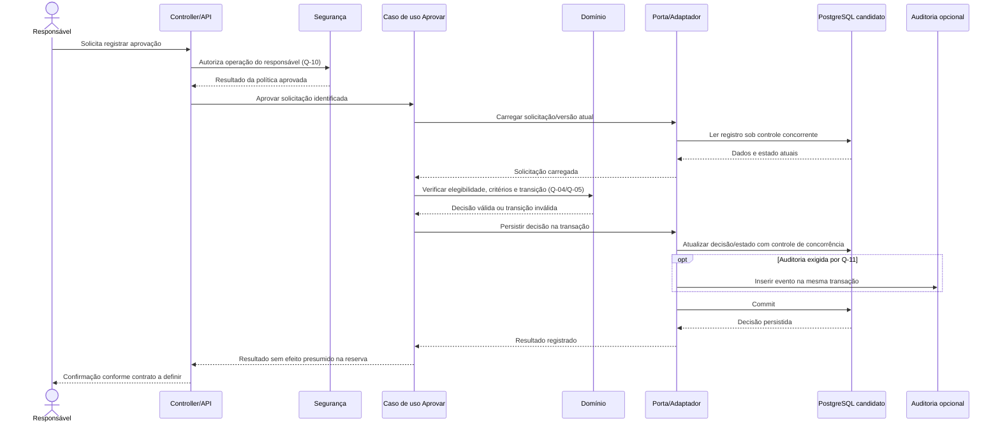
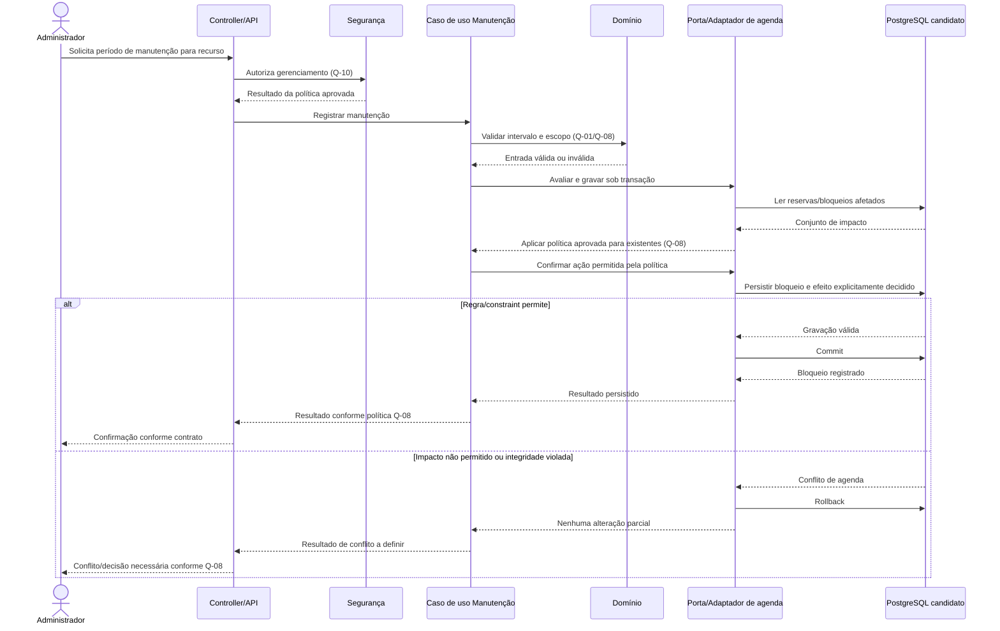

# Sequências propostas

Os diagramas descrevem interações candidatas entre os componentes de [contêineres](conteineres.md) e [componentes](componentes.md). Endpoints, nomes, estados e códigos HTTP são ilustrativos, não contratos aprovados. Os fluxos de reserva pressupõem que as decisões Q indicadas tenham sido tomadas; nenhum estado de negócio foi inventado. Decisões de concorrência, transações e erros estão em [ADR-003](../adr/ADR-003-protecao-contra-dupla-reserva.md), [ADR-004](../adr/ADR-004-fronteiras-transacionais.md) e [ADR-009](../adr/ADR-009-erros-http.md), ainda não aprovados.

## 1. Criação de reserva

Pré-condição conceitual: critérios de intervalo, recursos e estados já definidos (Q-01/Q-02/Q-04). A pré-consulta ajuda a dar feedback, mas não é garantia contra corrida. A constraint é candidata e só se aplica se o modelo aprovado permitir.

```mermaid
sequenceDiagram
    actor S as Solicitante
    participant API as Controller/API
    participant SEC as Segurança
    participant UC as Caso de uso Criar Reserva
    participant DOM as Domínio
    participant REP as Porta/Adaptador de reserva
    participant DB as PostgreSQL candidato
    participant AUD as Auditoria opcional

    S->>API: Envia solicitação de reserva (contrato a definir)
    API->>SEC: Autoriza identidade e operação (Q-10)
    SEC-->>API: Resultado da política aprovada
    API->>UC: Criar reserva
    UC->>DOM: Validar intervalo, recursos e transição (Q-01/Q-02/Q-04)
    DOM-->>UC: Comando válido ou erro de domínio
    UC->>REP: Iniciar gravação transacional
    REP->>DB: Consultar disponibilidade (informativa)
    DB-->>REP: Estado observado; pode mudar concorrentemente
    REP->>DB: Gravar reserva e ocupações/alocações
    alt Persistência aceita
        DB-->>REP: Gravação válida
        opt Auditoria exigida por Q-11
            REP->>AUD: Inserir evento na mesma transação
        end
        REP->>DB: Commit
        DB-->>REP: Commit confirmado
        REP-->>UC: Reserva persistida
        UC-->>API: Resultado conforme Q-04/Q-09
        API-->>S: Resposta conforme contrato aprovado
    else Constraint/concorrência rejeita gravação
        DB-->>REP: Violação de integridade
        REP->>DB: Rollback
        REP-->>UC: Conflito técnico convertido em resultado de domínio
        UC-->>API: Resultado por requisição pendente de Q-09
        API-->>S: Resposta de conflito a definir (409 é candidato)
    end
```

## 2. Aprovação

A sequência não presume que toda reserva necessite aprovação nem que aprovar altere disponibilidade. Solicitação especial, elegibilidade, critérios e efeito aguardam Q-04/Q-05/Q-10; auditoria depende de Q-11.



## 3. Conflito de horários

O cenário pressupõe que a definição de conflito/ocupação tenha sido aprovada (Q-01/Q-02/Q-04). Um conflito encontrado em consulta é feedback; a gravação precisa de proteção final no banco.

```mermaid
sequenceDiagram
    actor S as Solicitante
    participant API as Controller/API
    participant UC as Caso de uso Criar Reserva
    participant DOM as Domínio
    participant REP as Porta/Adaptador
    participant DB as PostgreSQL candidato

    S->>API: Envia recurso e intervalo
    API->>UC: Criar reserva
    UC->>DOM: Aplicar definição aprovada de conflito
    DOM-->>UC: Comando estruturalmente válido
    UC->>REP: Consultar disponibilidade (informativa)
    REP->>DB: Consultar ocupações existentes
    DB-->>REP: Resultado da consulta
    REP-->>UC: Ocupação sobreposta encontrada
    UC->>DOM: Avaliar conflito segundo Q-02/Q-04
    DOM-->>UC: Requisição conflita
    UC-->>API: Resultado de conflito sem gravação
    API-->>S: Conflito; status/corpo conforme Q-09 (409 candidato)
```

Se a consulta não encontrar conflito, uma gravação concorrente ainda pode vencer a corrida; consultar o fluxo de duas solicitações. Para disponibilidade por quantidade, o teste/decisão precisa refletir capacidade, não apenas existência de uma linha conflitante.

## 4. Duas solicitações simultâneas

Exemplo técnico candidato com constraint de exclusão para recurso discreto. O banco arbitra a escrita concorrente; o vencedor não é garantido por ordem de chegada e o resultado de negócio para cada solicitação não foi decidido (Q-09).

```mermaid
sequenceDiagram
    actor S1 as Solicitante A
    actor S2 as Solicitante B
    participant API as API
    participant UC1 as Caso de uso A
    participant UC2 as Caso de uso B
    participant REP as Porta/Adaptador PostgreSQL
    participant DB as PostgreSQL / transações

    par Solicitação A
        S1->>API: Criar reserva para recurso/intervalo X
        API->>UC1: Executar comando A
        UC1->>REP: Gravar A na transação
        REP->>DB: BEGIN; inserir ocupação A
    and Solicitação B
        S2->>API: Criar reserva conflitante para X
        API->>UC2: Executar comando B
        UC2->>REP: Gravar B na transação
        REP->>DB: BEGIN; inserir ocupação B
    end
    Note over DB: Constraint/isolamento candidato serializa ou rejeita uma escrita conflitante
    DB-->>REP: Uma transação pode confirmar
    DB-->>REP: A outra pode receber conflito de integridade
    REP-->>UC1: Resultado da gravação A
    REP-->>UC2: Resultado da gravação B
    UC1->>REP: Confirmar transação se aceita
    REP->>DB: COMMIT se aceita
    UC2->>REP: Desfazer transação se rejeitada
    REP->>DB: ROLLBACK se rejeitada
    UC1-->>API: Resultado conforme Q-09
    UC2-->>API: Resultado conforme Q-09
    API-->>S1: Resposta individual conforme decisão
    API-->>S2: Resposta individual conforme decisão
```

O diagrama não fixa qual transação vence, status final alternativo, retry ou código HTTP. Teste de aceitação deve provar que o estado final respeita o invariante aprovado e que as duas respostas seguem Q-09. Locks pessimistas ou isolamento serializável são alternativas descritas em [arquitetura](../arquitetura.md#integridade-concorrencia-e-erros).

## 5. Bloqueio por manutenção

O exemplo representa uma tentativa de registrar período; não escolhe o efeito sobre reservas já existentes. A política de Q-08 deve ser aplicada antes de persistir/ativar o bloqueio. Um bloqueio não deve cancelar ou sobrescrever reserva silenciosamente.



**Ponto de decisão:** a política pode permitir somente bloqueios sem reserva coincidente, preservar reservas existentes, encaminhá-las a tratamento ou outra opção aprovada. Até a escolha, o diagrama é um contrato de fronteira transacional, não comportamento fechado. Se a restrição compartilhada impedir criar bloqueio sobre reserva, isso é uma alternativa técnica, não a decisão de produto sobre impacto.